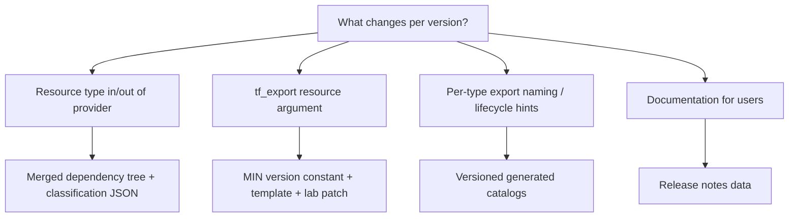

# Provider version gating

How the site and generated artifacts stay correct when the Genesys Cloud Terraform provider adds or removes resources, export behavior, or `genesyscloud_tf_export` arguments across releases.

The version picker loads **per-version data** for most of the explorer. Some behavior needs explicit **minimum (or range) version** checks in app code or lab zip build steps.

---

## Decision tree

| What changes between releases? | Mechanism | Maintainer action |
|--------------------------------|-----------|-------------------|
| Resource type appears or disappears | `dependency-tree-merged-json/{version}.json` | Cache that provider version (`npm run download-provider-versions` / CI bootstrap); run merge generators. |
| Deprecated / non-exportable / cannot-destroy | `resource-classification/{version}.json` + optional `overrides.json` extras | Regenerate classification; adjust overrides if scans miss edge cases. |
| Export block name, singleton, force-new columns | `tf-export-resource-names/`, `tf-export-singletons/`, `schema-force-new/` per version | Run the matching generators for new versions. |
| New or removed **`genesyscloud_tf_export` argument** | `MIN_*_VERSION` + conditional HCL + lab patch | See [Export resource arguments](#export-resource-arguments) below. |
| Changelog / attribute history (UI only) | `public/release-notes-data/` | Release-notes pipeline; does not drive templates by itself. |



---

## Per-version JSON (resources in / out of the list)

When the user selects a version, the app fetches:

- **Dependencies:** `dependency-tree-merged-json/{version}.json` (merged from release `dependency_tree` assets + `overrides.json` patches).
- **Classification badges:** `resource-classification/{version}.json`.

The left-hand resource list and dependency graph reflect **only types present in that tree**. No extra “hide this type on 1.70” logic is required when a type did not exist yet.

**If a type is missing after bootstrap:** confirm the release asset exists, merged tree was regenerated, and the type is not in `hiddenResourceTypes`.

---

## Per-version generated catalogs (export behavior per resource)

These files are generated **once per cached provider version** (same version list as dependency trees):

| Directory | Purpose |
|-----------|---------|
| `tf-export-resource-names/` | Placeholder in `include_filter_resources` (`<name>`, `<type>_<name>`, …) |
| `tf-export-singletons/` | Types with `IsSingleton` (with UI floor — see constants) |
| `schema-force-new/` | Attributes that recreate the resource on change |

The explorer and spreadsheet generator load the file that matches the selected version. **Regenerate** when provider export logic changes; avoid hand-editing versioned JSON except via generators.

**Singleton floor:** `MIN_SINGLETON_FLAG_VERSION` (`1.78.0`) — below that release, the site does not treat `IsSingleton` from catalog data the same way (`App.jsx`, `generate-spreadsheet-template.mjs`).

---

## Export resource arguments

Example: `export_omit_unresolved_refs` (introduced in **v1.84.0**). Older provider versions must not show that line in the copyable template or lab `main.tf`.

### Shared pieces

1. **Constant** — `scripts/lib/public-data-path-constants.mjs`:

   ```js
   export const MIN_EXPORT_OMIT_UNRESOLVED_REFS_VERSION = "1.84.0";
   ```

   Re-export from `src/publicDataPaths.js` when the React app needs it. In `src/tfExportTemplate.js`, import the constant from `scripts/lib/public-data-path-constants.mjs` (not `publicDataPaths.js` — that module uses Vite `import.meta.env` and breaks Node generators such as `generate-spreadsheet-template.mjs`).

2. **Compare** — `scripts/lib/provider-version-compare.mjs` (`compareProviderVersions`, `providerVersionAtLeast`). Prefer this in generators; `App.jsx` still has a local `compareVersions` for a few UI gates.

3. **Site template** — `src/tfExportTemplate.js`:
   - `supportsExportOmitUnresolvedRefs(providerVersion)` (or equivalent per attribute).
   - `buildTfExportAttributes(..., { providerVersion })` includes the HCL line only when supported.
   - For `latest` or empty version before index load, treat as **supported** so the newest release does not briefly show stripped HCL.

4. **Version from picker** — `App.jsx` passes `providerVersion`: `selectedVersion === "latest" ? newestListedRelease : selectedVersion` into `buildTfExportTemplate`.

5. **Lab packages** — Source templates under `scripts/templates/cx-as-code-lab/` include **current** recommended HCL. At zip build time, `scripts/generate-lab-package.mjs` patches each `.tf` file:
   - `patchProviderVersionPins` — pin `genesyscloud` to the zip version.
   - `patchTfExportOmitUnresolvedRefs` — **remove** lines for arguments not present in that provider release (`scripts/lib/lab-package-version.mjs`).

   Regenerate zips after template or patch changes:

   ```bash
   npm run generate-lab-package -- --force
   ```

### Checklist for a new `genesyscloud_tf_export` argument

1. Confirm introducing release (often already in `public/release-notes-data/tf-export/`).
2. Add `MIN_EXPORT_<NAME>_VERSION` in `public-data-path-constants.mjs`.
3. Add `supportsExport<Name>()` and conditional lines in `buildTfExportAttributes`.
4. Add or extend a `patchTfExport…()` used from `patchTerraformFiles` in `generate-lab-package.mjs`.
5. Update lab template `main.tf` files if the line should appear on **current** provider versions.
6. Run lab (and deploy) generators so published `/labfiles/{version}` zips match.

### Many export attributes

Until the list grows large, one `supports…()` helper per attribute is fine. A small table-driven list in `tfExportTemplate.js` is reasonable if several arguments share the same pattern:

```js
const TF_EXPORT_VERSIONED_ATTRS = [
  { name: "export_omit_unresolved_refs", minVersion: MIN_EXPORT_OMIT_UNRESOLVED_REFS_VERSION, value: "true" },
];
```

Lab patches can mirror the same list (strip lines when `!providerVersionAtLeast(version, minVersion)`).

### Attributes removed in a *newer* release (rare)

The repo mostly uses **floor** gates (`>= MIN`). For a attribute that only exists in a range, add an optional **ceiling** (`MAX_*_VERSION`) or `providerVersionInRange(min, max)` in the template builder and lab patcher, and emit the old name below breaking changes if the provider renamed an argument.

---

## `MIN_*` constants reference

Defined in `scripts/lib/public-data-path-constants.mjs`; summarized in the root [README](../README.md#generated-public-data-paths).

| Constant | Typical use |
|----------|----------------|
| `MIN_DEPENDENCY_TREE_VERSION` | Oldest cached tree; lab template provider placeholder |
| `MIN_RESOURCE_PERMISSIONS_VERSION` | Role TF / permissions downloads |
| `MIN_SINGLETON_FLAG_VERSION` | Singleton badge and spreadsheet notes |
| `MIN_EXPORT_OMIT_UNRESOLVED_REFS_VERSION` | `export_omit_unresolved_refs` in template + lab zips |

Keep CI env vars `MIN_DEP_VERSION` / `MIN_PERM_VERSION` in `download-provider-versions.sh` and `.github/workflows/deploy-pages.yml` aligned with the dependency-tree and permissions constants.

---

## Release notes vs behavior

`public/release-notes-data/` (including `tf-export/resource-attribute-index`) powers release-note dialogs and search. It does **not** automatically change the export template or lab files.

After documenting a new export argument in release notes, still implement [Export resource arguments](#export-resource-arguments) so the version picker and lab downloads stay valid.

---

## Related docs

- [Build chain & rerun guide](build-chain.md) — when to rerun generators after a failed step.
- Root [README](../README.md) — `overrides.json`, lab packages, generated `public/` paths.